# U1 Print Hub

**🏆 Tier 3 award winner in Snapmaker's Innovation Fund (Phase 1, October 2026).**
Thank you to Snapmaker, and to everyone who has tried the Hub, reported a bug
or sent in an idea - a lot of what's below started as one of those.

One dashboard for a whole farm of Snapmaker U1 printers. Other Klipper printers
can join in too (that part is in beta).

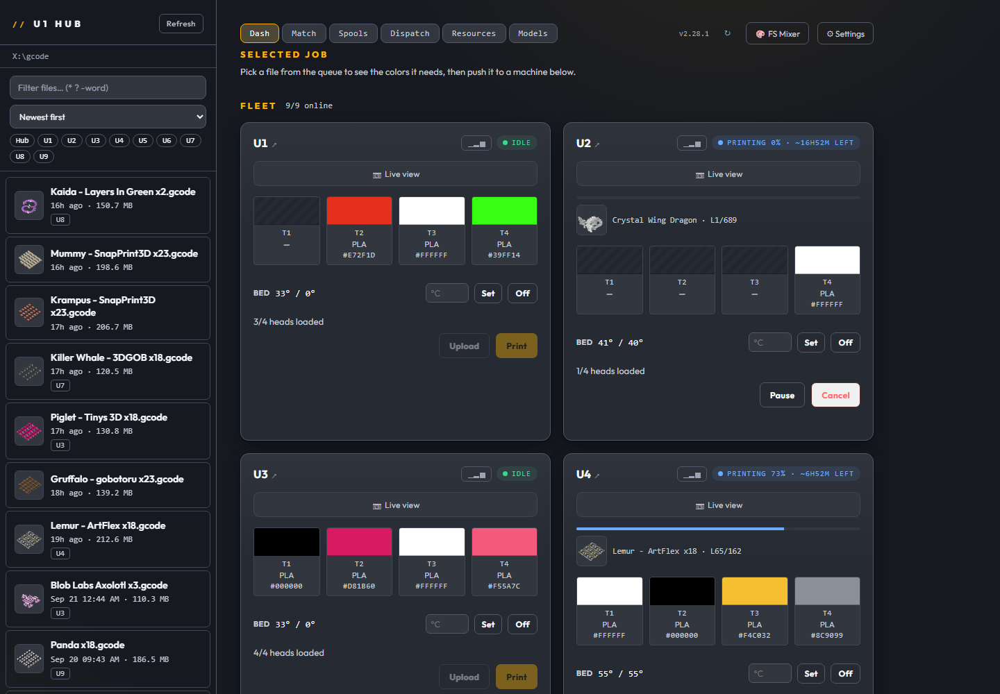

You run the Hub on a computer that stays on. Your phone, or any browser, opens
it like a web page. From there you can see every machine at once, send prints,
watch cameras, plan your printing week, know what filament to buy before you
run out, and - new in 2.28 - ask what settings a model wants before you slice
it, and whether a plate is worth printing at all.

Nothing gets installed on the printers. The Hub talks to the software they
already run, and nothing leaves your network unless you turn remote access on,
ask for a phone notification, or press one of the two AI buttons with your
own key in place.

---

## What it does

**See the whole farm at a glance.** Every printer gets a card with its live
status, progress, loaded colors, camera, and bed temperature. A print that
paused or failed says why, in the firmware's own words, so you know whether to
walk over. A printer that is down for maintenance says so right on the card,
and the scheduler routes work around it until you bring it back. Tap a
head's color on an idle printer to change it, pick the material, and it stays
on the printer just like a color set on the touchscreen. Pause, resume and
cancel show a spinner until the printer answers and ignore a second tap in
the meantime, so a slow printer can't get the same command twice.

**Send prints without walking over.** Pick a file, see the colors it needs,
choose which head prints which color, and push it to any idle machine. The Hub
suggests a head for each color by matching the material first and the color
second, so a PETG part goes to the PETG roll even when PLA in the same color is
loaded too, and it warns you if the head you pick holds something else. Files
live in one merged list: the Hub's library plus whatever is stored on each
printer, with thumbnails. A file that only lives on one printer (sliced
straight to it) can be copied into the Hub library with one tap, so you can
queue it, plan it, or send it to any other machine.

**Let the Hub pick the printer.** Select a file and press Print on best
printer. The Hub looks at every idle printer and picks one that already has
every color the file needs loaded, close in shade and the right material.
It tells you which one and gives you five seconds to cancel before it sends.
If nothing fits, it says which printer came closest and what it's missing,
and when that's only a color or two you can send it there anyway - it shows
you which loaded roll would stand in for each missing color first.

**Know whether it is worth printing.** Under every file you select, one line
says what its filament costs, the least it has to sell for (per piece when the
file name carries the plate count, like `Penguin x20.gcode` - see
[the x number](#the-x-number-in-a-file-name) below), and what that
comes to per printer hour. Type what a piece really sells for in the box
beside it and you get the real numbers: what the plate brings in, dollars per
printer hour, dollars per gram, margin over filament. Save it, and the table
link lists every file you have priced, most profitable per printer hour
first, so you can see which models carry the farm and which just keep it
busy. The two rates behind the floor - your sell floor per gram and what
filament costs you per gram - are in Settings. The Hub never decides anything
from this; it is the number to look at before you queue a plate.

**Get a second pair of eyes before you press print.** With your own Anthropic
API key in Settings, the AI pre-flight button on the job card has Claude read
the settings baked into the sliced file and compare them with what is actually
loaded in the printer you picked: wrong material or temperature for a head, an
empty head a color needs, a missing prime tower, bed temperature wrong for the
plate. You get GO, CHECK or STOP and the reasons, most important first.

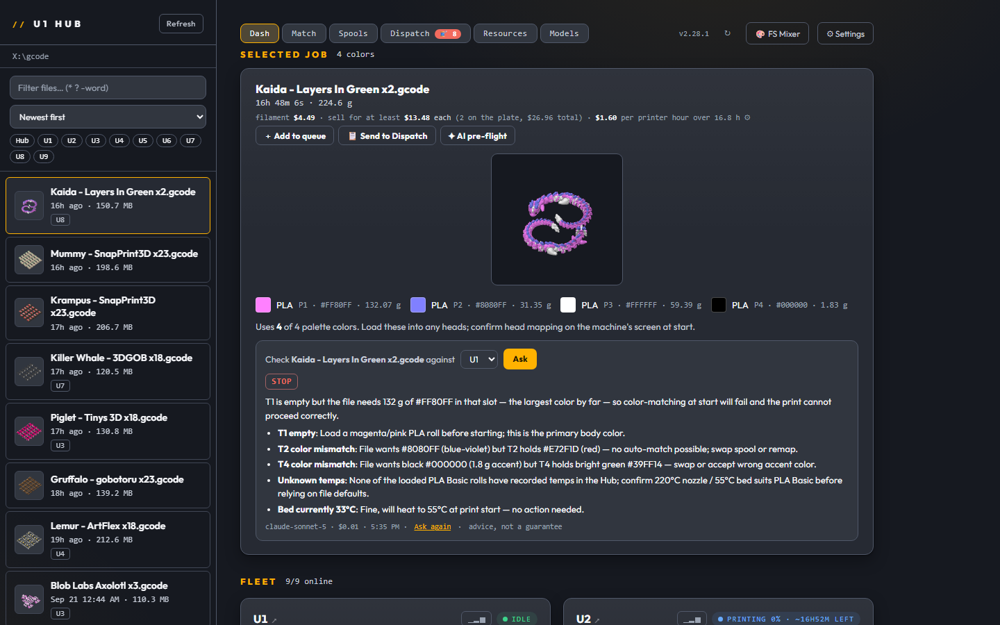

**Browse the models you have not sliced yet.** The Models tab reads a folder
of 3MF project files (Designer\Model\file.3mf, the way designers ship them)
and shows each one with the plate render saved inside it, the colors it was
painted with, and the objects on the plate. Open in Orca launches it in
Snapmaker Orca on the Hub computer; when you save the gcode, the Hub notices
and offers to select it or send it to Dispatch, and that line goes away once
the file is in Dispatch. The shelf opens newest first, so what you just saved
is at the top, and each card carries a thin strip of the model's own colors.
The designer list shows your twelve biggest designers plus a search box for
the rest, and if a folder name is wrong or two folders are really the same
designer, the Designer names box under ⚙ Folder fixes the name without moving
a file. The filter, designer and sort you pick stay in the address bar, so a
refresh or a shared link opens the same shelf. The shelf can be tidied from
the shelf, too: Rename files a model as `Designer\Name\Designer - Name.3mf`
(it shows you where first), Attributes fixes a designer or name the folders
got wrong and offers the same move, and Delete removes a file for good after
one confirm. Sort it by designer, name, newest, oldest, random, or most
printed - that last one counts the completed jobs in your printers' own
history against the files they were sliced from, and says how many it could
match rather than guessing. While a rescan runs in the background the shelf
holds still - no flashing, no jumping, no dimming - and only the count line
moves. Convert to U1 (behind the ⋯ on a card) writes a
U1 copy of a MakerWorld or other Bambu project beside it, keeping the
designer's prime tower, walls, infill and supports on your U1's printer and
filament presets.

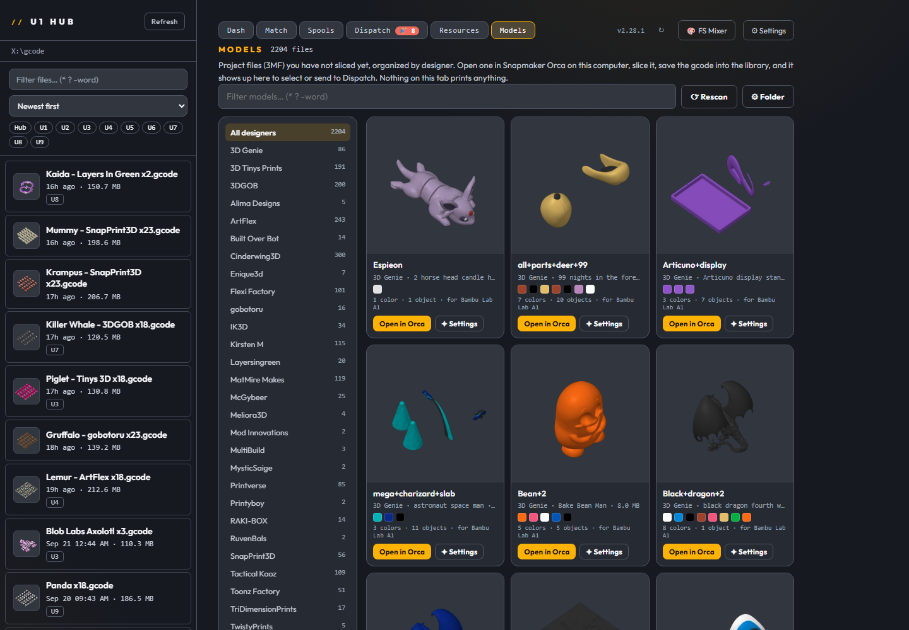

**Take print requests from 3MF Explorer.** 3MF Explorer is a separate, free
app from the same place (it has its own download on the Releases page): a fast
searchable index of a whole 3D model library, thumbnails, designers,
duplicates and all. Pair it with the Hub once, and anyone browsing it can
select a model and press Mark for print. The request shows up on the Hub's
Models tab under Requested. As soon as that model's gcode is saved from Orca
(or you link one by hand with Link gcode behind the ⋯), the Hub queues one
print of it in Dispatch on its own. To pair them, open Models, then ⚙ Folder:
the Hub shows its address and a token to copy into 3MF Explorer's settings.
Both apps need to be looking at the same model library, but they don't have
to reach it the same way - one can use a mapped drive letter and the other the
network path, or 3MF Explorer can run on a different computer.

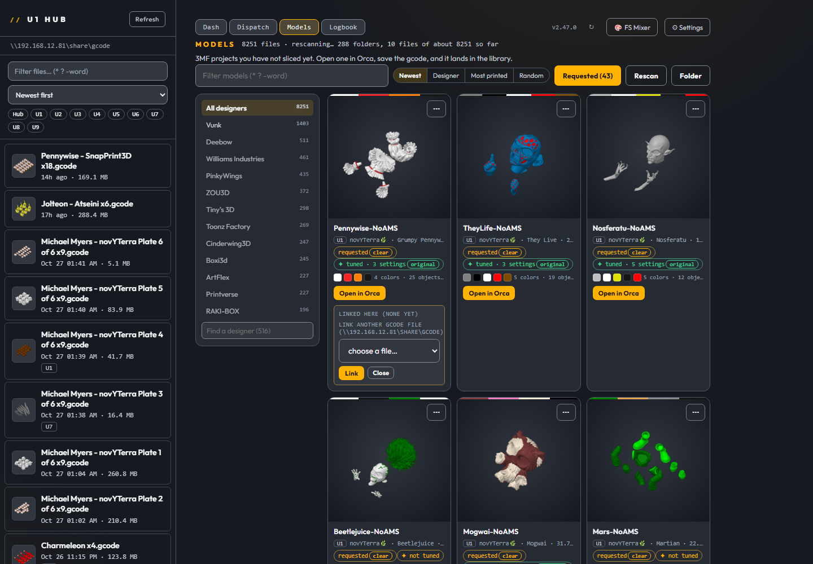

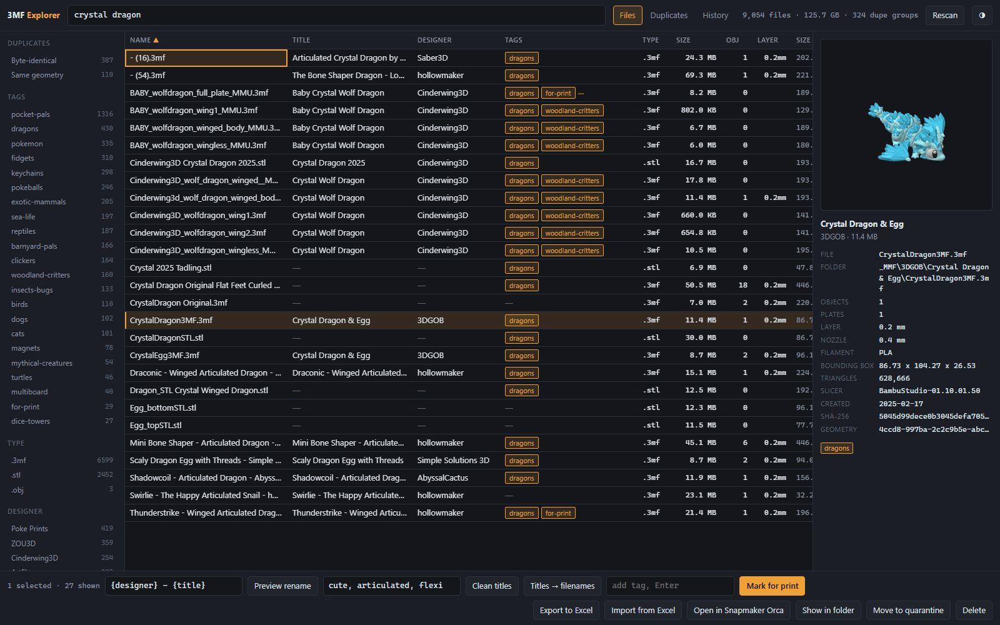

**Ask what settings a model wants.** The Settings button on any Models card
has Claude suggest the slicer settings for that file on the printer you pick,
before you slice - a table of setting, the value to use, what the designer's
profile had, and why. It is specific to the model because of what goes with
the question: the plate picture from inside the file, numbers the Hub measures
from the actual meshes (size, how much of the surface overhangs, undersides
that float, how much touches the bed, painted faces, volume), the designer's
own project settings, and what is loaded in your printer. It maps the
project's colors to your loaded heads when it can, and lists what to watch.
Under the table, Open in Orca with these settings opens a copy of the file in
Orca with those suggestions already filled in, marked as changes so you can
put any of them back. Your own file is never touched; keep the tuned project
with Save As in Orca, or let the copy clean itself up after three days.

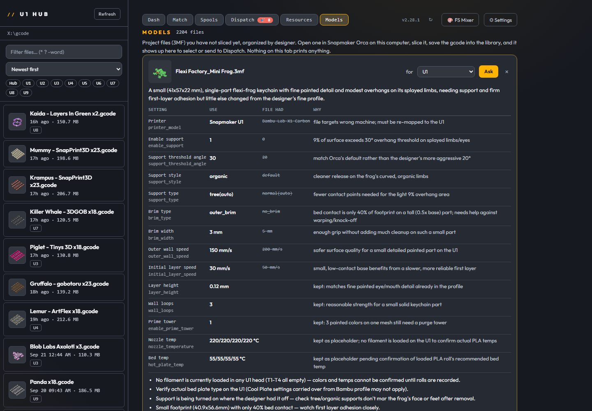

**Plan your whole printing day.** The Dispatch tab schedules your queue across
every printer, inside the hours you are actually home to swap plates. It flags
jobs that want the same spool at the same time, lets you push a job back a
place, and adopts prints that are already running. The key under the timeline
explains every mark a bar can carry: spool swaps before it starts, a color
another printer needs at the same time, and a wait for someone to clear the
bed. There is also a setting for what a printer does with its rolls when a
print finishes: keep them all loaded, unload only the ones the next job on
that printer doesn't use, or unload every roll the print used. As of 2.40.2
it is switched off and every roll stays loaded, while we check whether
unloading after every print is behind some nozzle clogs.

The plan gets better the more you print. Every finished copy records how long
it really took, so a file you have run before is planned at its own real time
instead of the slicer's guess, and you can type a time on a job yourself. Tap
any block on the timeline and "Why here" tells you why it landed on that
printer and what the next best choices would have cost. The timeline redraws
itself as printers finish, a copy that finishes while the Hub is restarting
still counts, and a cancelled or failed print frees its printer right away
and keeps that copy on the list with a note on the job. You can reorder your
printers in Settings without anything moving to the wrong machine. When
several prints are due to finish overnight, the plan lines the bed clears up
five minutes apart instead of asking you to clear three at once.

Getting around the timeline is easy from anywhere on it. It fits in the
window, with the time ruler pinned to the top and its scrollbar always in
view. Earlier and later buttons page through the day and now jumps back to
the present. With a mouse you can drag the lanes, and the arrow keys work
once you've clicked into it. On a phone, swipe it any direction - it keeps
your place while it refreshes, so the last printer is always within reach.

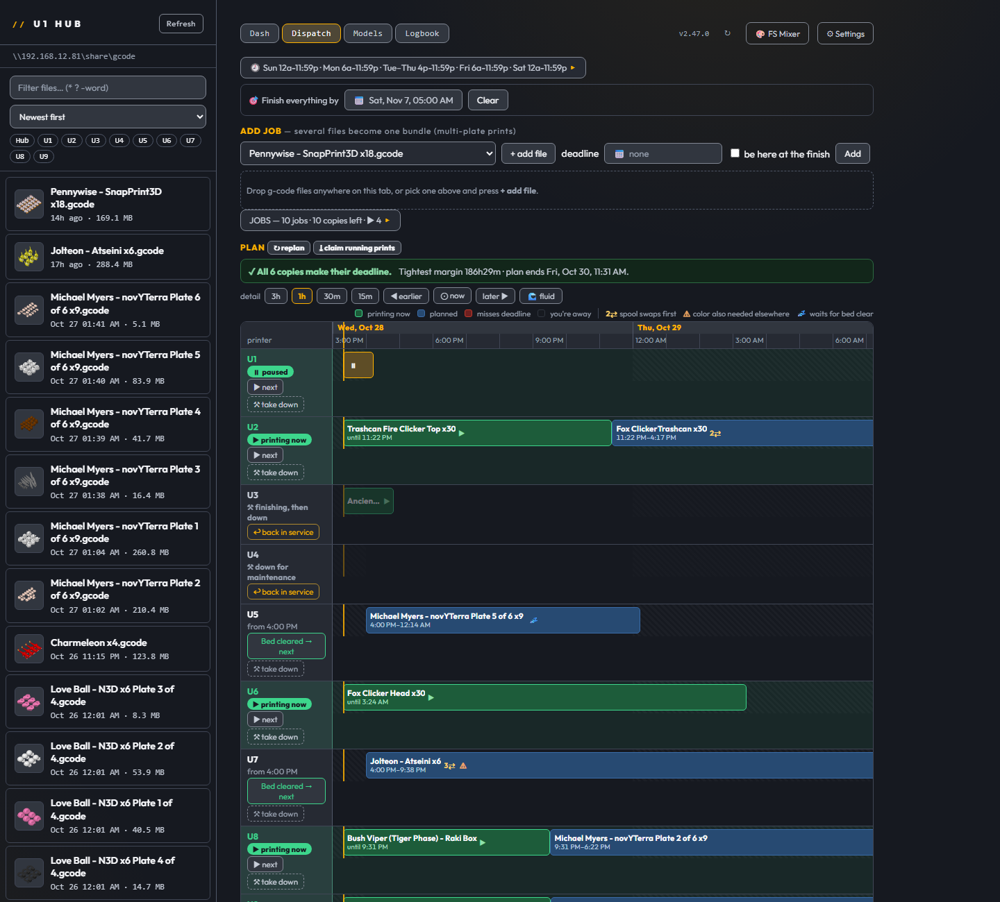

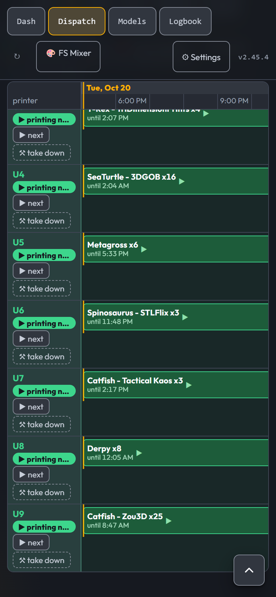


**Know what to buy.** The Resources tab reads every scheduled file, adds up
the filament by color, compares it to the spools you own, and shows what you
are short. Every row gets a Replenish on Amazon button that searches for that
exact filament.

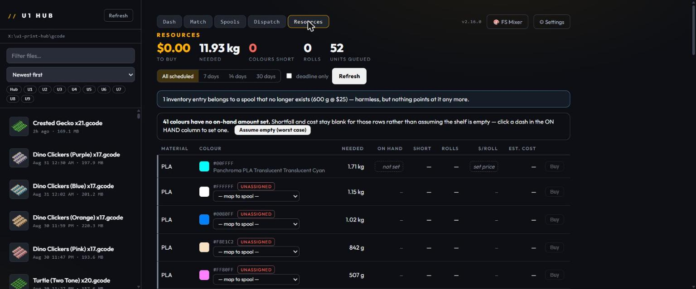

**Give every spool an identity.** Scan a spool's RFID tag with your phone, or
print a QR label for rolls that have no tag. The Hub remembers the brand,
color, and temps, tracks which machine each spool is loaded in, and tracks
grams left and price per roll. When a print finishes, the grams each head used
come off the roll that was in it, with the cost of that print at the price you
paid, and an Undo if it got one wrong. Already keep your rolls in
[Spoolman](https://github.com/Donkie/Spoolman)? Import them in one click. If
you want Spoolman to stay your master list, tick one box and the grams each
print uses get recorded there too - only the grams, nothing else about your
rolls is ever changed.

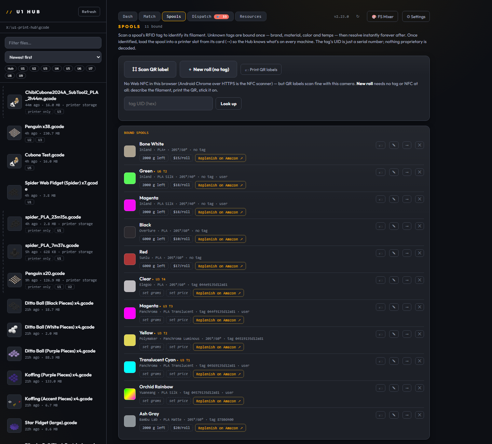

**Ask "what can I print right now?"** The Match tab reads the colors loaded
on each printer and lists the library files those colors can already produce,
best match first, one tap from printing.

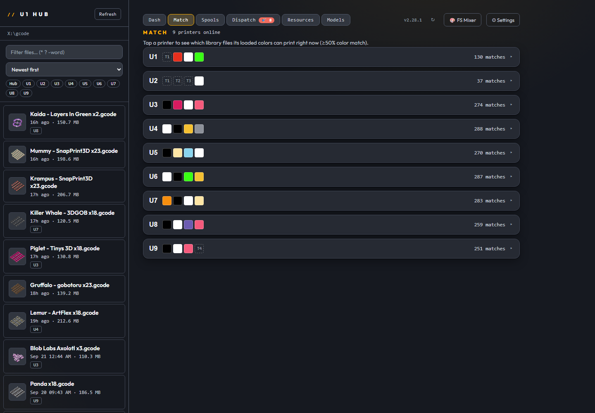

**Keep a logbook for every printer.** The Logbook tab records what went
wrong on each machine, what fixed it, and how many print hours it had at the
time, so the next time a nozzle clogs you can search "clog" and see what
worked last time. The Hub fills in what it already knows: a pause or error
the printer reports with a reason is logged by itself, and taking a printer
out of service opens an entry that asks what fixed it when it comes back.
Add upkeep that comes round again, every so many print hours (read from each
printer), every so many days, or both. What's due shows on the printer card,
the Done button logs it, and your phone can get a heads-up when something
comes due.

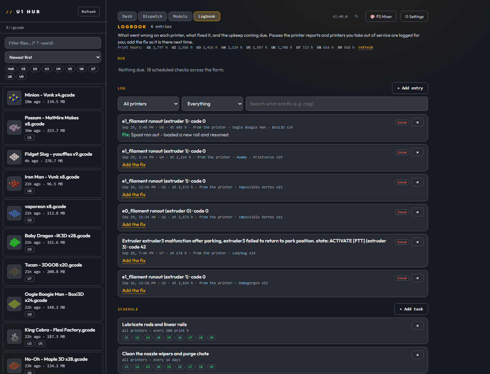

**Keep a timelapse of every print.** Turn on Timelapses in Settings and pick
a folder. While a U1 prints, the Hub grabs a frame from its chamber camera each
time a new layer starts, and when the print finishes it turns them into a
short video in that folder, named after the printer, the file and the time.
Cancelled and failed prints are thrown away. It needs the free
[ffmpeg](https://ffmpeg.org/download.html) installed on the Hub computer, and
the Settings card tells you whether it found it. A Hub restart in the middle
of a print picks the same video back up instead of starting over.

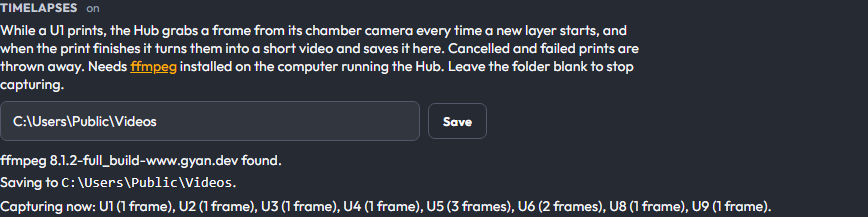

**Let your phone tell you.** Settings can send push notifications through
[ntfy](https://ntfy.sh) (free, no account) when a print finishes, a printer
pauses (with the reason), errors, or stops answering. Pick the events you want;
one box turns it all off.

**Open any printer's own control page in one click.** Click a printer's name
and its full Klipper interface (Fluidd) opens, no typing IP addresses. On your
network it opens the printer directly, so its live data and controls work
exactly as they do when you visit the printer on its own.

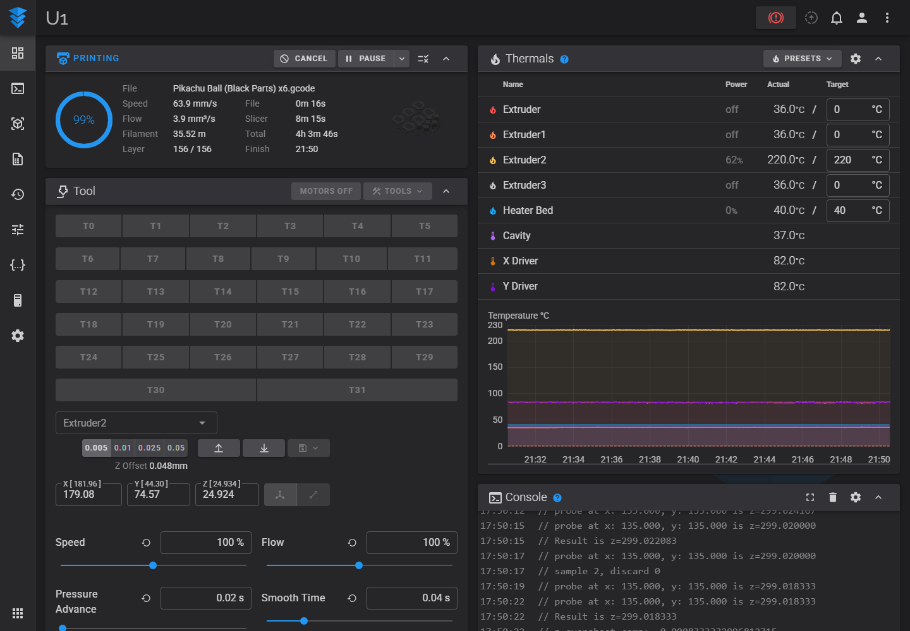

**Use it from your phone.** The whole thing is built for a phone screen. Add
it to your home screen and it behaves like an app. Every label, button and
field is checked for contrast, so it stays readable on a dim shop screen or a
phone in daylight, whatever accent color your printer types use. The Models tab works on a
phone too: two columns of cards, the file library tucked behind a Library
button, Convert to U1 right on the card, and the rest (Suggest settings, Link
gcode, Attributes, Rename, Delete) behind the ⋯ menu. Only Open in Orca needs the Hub computer itself, because it
opens a program there. A tab you are not looking at stops checking for
updates, so a phone in your pocket is not using data on the Hub's behalf.
And however many pages are open, the Hub asks each printer how it's doing
once per pass and shares that one answer with everything, so a big farm
isn't being asked the same question four different ways.

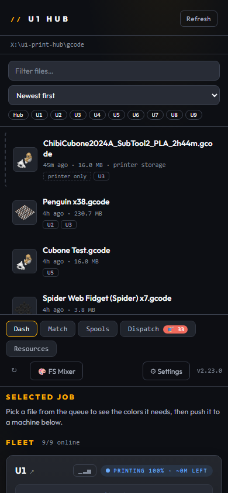

There is more in the drawers: smart plug power control with a guard that
refuses to cut power mid-print, a Full Spectrum mix planner, per-printer
stats and temperature graphs, skip-an-object mid-print, a shared print queue,
and printable QR spool labels. The [long version](docs/CHANGELOG.md) covers
everything in detail, release by release.

---

## The x number in a file name

Most of the Hub works with any file name. A few features get smarter when a
gcode file is named like this:

```
Title - Designer x24.gcode
```

**The x number is how many pieces are on that one plate.** `Penguin - Maker
x24.gcode` is a single print that makes 24 penguins. It is not 24 prints.

Here is what reads it:

- **Worth printing** divides by it. The line under a selected file shows the
  least each piece has to sell for, and the What sells table multiplies the
  price you type by it to get what the whole plate brings in. With no x
  number, the plate is treated as one piece and there is no per-piece price.
- **Print requests** record it. When a request from 3MF Explorer finds its
  gcode, the Hub queues one print of that file, and the Models card shows it
  as queued with 24 pieces. You set how many times to print it in Dispatch,
  like any other job.
- **Most printed** ignores it on purpose. When the Hub matches finished jobs
  back to your 3MF files, `Penguin - Maker x24` and `Penguin x20` both count
  toward the same Penguin model.

The rules for writing it:

- `x24`, `x 24`, `24x` and `×24` all work, upper or lower case.
- It has to stand on its own, separated by a space, dash, underscore or
  bracket. `Box20` and `Onyx 3` do not count as numbers of pieces.
- Up to three digits (999 pieces).

**The Title - Designer part** is what the Hub matches against your 3MF
library. When you save a gcode from Orca after pressing Open in Orca, or when
a print request is waiting, the Hub checks that the new file's title matches
the model you opened, and ignores the designer's name while it compares.
That is how it tells two files apart when two slices land in the folder at
the same time. A file that does not match is still linked, but marked
unverified on the card, so you can fix it with Link gcode.

---

## Getting started

**There is no phone app to install.** The Hub runs on a computer (Windows,
Mac, or Linux) that stays on. Your phone just opens it in a browser.

**Easiest: download a build.** Grab the one for your system from the
[Releases](../../releases) page, put it in its own folder, and run it. A
browser opens to the dashboard, and Settings walks you through adding your
printers.

A few first-run notes:

- Windows may warn about an unknown publisher. Click More info, then Run anyway.
- On a Mac, right-click the file and choose Open the first time.
- On Linux, `chmod +x` the file, then run it.
- Only one copy can run at a time. If it flashes and closes, another copy
  already has port 4545.

**From your phone:** open `http://THE-COMPUTER'S-IP:4545`, then use your
browser's Add to Home Screen.

**Docker, for a Pi or NAS:**

```bash
git clone https://github.com/dlgambill/u1hub.git
cd u1hub
mkdir -p data gcode
docker compose up -d
```

Everything the Hub remembers (printers, password, tunnel, spools, schedule)
lives in `./data` on the host, so upgrading is `git pull` and
`docker compose up -d --build` with nothing to redo. If you set up with the
older compose file, which only kept `config.json`, move that `config.json`
into `./data`, and copy your old container's `spools.json`, `slots.json`,
`dispatch.json`, `auth.json` and `tunnel.json` in beside it once
(`docker cp u1-print-hub:/app/spools.json data/` and so on).

**From source:** install Node.js 22 or newer, then run `start-windows.bat` or
`./start-mac-linux.sh`. First launch installs what it needs and opens the page.

**To turn on the AI buttons:** make a key at
[platform.claude.com](https://platform.claude.com/) (API keys, Create key; it
starts with `sk-ant-`), add a few dollars of credit there, and paste it into
Settings under AI pre-flight. The key stays in `config.json` on the Hub
computer and is never shown again. Both buttons are off until a key is in.

**It looks after its own files.** Every night the Hub copies everything it
remembers (printers, schedule, spools, logbook and the rest) into a
`backups` folder beside them and keeps the last seven days. If a settings
change can't be saved - a busy network share, say - it tells you instead of
showing Saved. If `config.json` gets hand-edited into something it can't use,
it names the setting that's wrong when it starts, and a file saved from
Windows PowerShell no longer quietly resets it to defaults. For a watchdog or
a home-lab monitor, `http://THE-COMPUTER'S-IP:4545/healthz` answers with the
version and printer count, no sign-in needed.

---

## Using it away from home

Two switches in the Hub, no router changes:

1. Set a password (Settings). The Hub refuses to go public without one.
2. Turn on the tunnel (Settings). The Hub sets up a free Cloudflare tunnel
   and gives you an HTTPS address that works from anywhere.

Everything the Hub itself shows works remotely this way: the fleet, sending
prints, cameras, spools, and scheduling. If the tunnel drops, the Hub starts
it again on its own, and the tunnel program it downloads is one pinned,
checked version rather than whatever is newest. While the tunnel is on, the
password stays on. If your sign-in expires after 30 days, the page takes you
to the sign-in screen and back to where you were. Lost a phone, or signed in
somewhere you shouldn't stay signed in? Sign out everywhere in Settings ends
every session at once. If the Hub sits behind your own reverse proxy, the
same card is where you list it as trusted. The printers' own Klipper pages are
best used on your own network; opening them from outside can depend on your
network setup.

---

## The honest fine print

**The AI buttons send data out, and only when you press them.** For a gcode:
a text brief of a few thousand characters - the file name, the slicer
settings Orca wrote into it, the filaments it was sliced for, the object
count, and what the Hub has recorded in that printer's heads. For a 3MF: the
measured numbers, the designer's settings, the loadout, and the small plate
picture from inside the file. Never the gcode or the meshes themselves, never
your printers' addresses. Settings has a link that shows you the exact brief
for any file before you trust it with a key. A pre-flight costs about a cent
on Claude Sonnet, a settings suggestion a few cents (the model thinks first),
and the same file against the same loadout is answered from a local cache for
free.

**Amazon links.** The Replenish on Amazon buttons carry an affiliate tag, so
the creator of this software earns a small commission if you buy through one,
at no extra cost to you. This is disclosed on the page itself, and there is a
checkbox in Settings to turn it off. Off means off: the links still work, they
just carry no tag.

**Update checks.** Once a day the Hub fetches one small public file to see if
a newer version exists. It sends nothing about you or your setup. One checkbox
turns it off, and off means no request is made at all.

**In-app slicing is not ready.** The checkbox for it ships off, and turning it
on warns you first. If you would like to help finish it, fork away.

**Other printer brands are beta.** The printer types feature works against
stock Klipper and Moonraker in testing. If yours misbehaves, use Download
diagnostics in Settings and attach the file to a
[GitHub issue](https://github.com/dlgambill/u1hub/issues/new/choose).

---

## Problems?

Open Settings, click Download diagnostics, and attach the file to a
[GitHub issue](https://github.com/dlgambill/u1hub/issues/new/choose). The file
is yours to review before you send it.

## License

MIT. See `LICENSE`. Free to use, change, and share.
